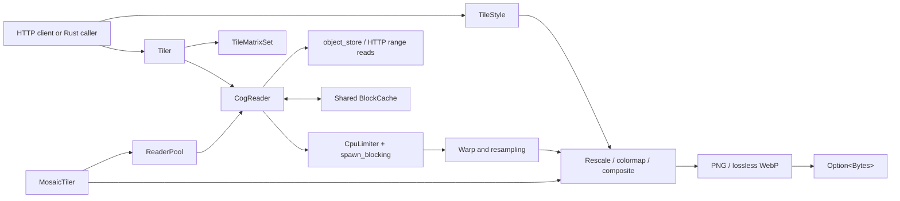

The library separates asynchronous range I/O from CPU-heavy decode, warp,
render, and encode work. Applications compose the public layers they need.

## Main components {#components}

| Component | Responsibility |
| --- | --- |
| `CogReader` | Open a COG, read metadata and overviews, select and stitch native blocks, and sample points or windows. |
| `BlockCache` | Share decoded native blocks across readers under one byte budget; coalesce concurrent cold fetches. |
| `Tiler` | Plan a tile, choose an overview, read the source window, warp when required, and render encoded bytes. |
| `TileStyle` | Validate Raster Style JSON/Q3 and bind supported rendering capabilities. |
| `MosaicTiler` | Find assets, open readers through a pool, warp each asset, reduce overlapping pixels, and render once. |
| `CpuLimiter` | Bound CPU-heavy blocking work across readers and tilers. |

## Tile data flow {#tile-flow}

1. `TileCoord` identifies a tile in a supported TileMatrixSet.
2. `Tiler` computes the destination bounds and checks whether they intersect
   the source dataset.
3. It selects an overview whose ground resolution is appropriate for the
   requested tile.
4. `CogReader` loads missing native blocks through range requests and reuses
   cached blocks where possible.
5. Same-CRS tiles use an affine fast path. Cross-CRS tiles use an inverse warp;
   EPSG:4326 ↔ EPSG:3857 has a closed-form fast path, while other pairs require
   the `proj` feature.
6. Source nodata is excluded before interpolation. The Raster Style pipeline
   evaluates channels, applies fixed-range stretching, Gamma, color mapping and
   opacity, then encodes PNG or lossless WebP. Metadata scale/offset calibration
   is currently rejected.

## Concurrency model {#concurrency}

Tokio drives asynchronous metadata and byte-range I/O. Decode, stitch, warp,
reduction, render, and encode jobs run through `spawn_blocking` behind a
semaphore. Applications can inject one `Arc<BlockCache>` across single-COG and
mosaic readers to avoid multiplying decoded-cache budgets. They can also inject
one `CpuLimiter` across non-mosaic `CogReader`/`Tiler` instances. Current
`MosaicTiler` uses its own internal limiter and cannot join that permit budget,
so mixed traffic has no automatic process-wide CPU cap.
