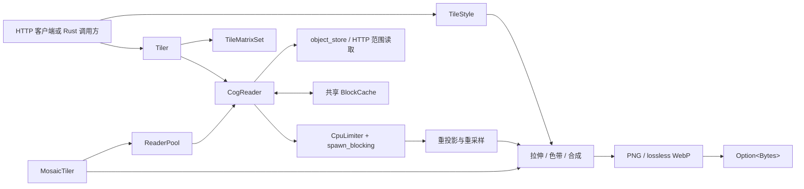

库将异步范围 I/O 与 CPU 密集型的解码、重投影、渲染和编码工作分离。应用只需组合
自己需要的公共层。

## 主要组件 {#components}

| 组件 | 职责 |
| --- | --- |
| `CogReader` | 打开 COG，读取元数据和概览层，选择并拼接原生块，以及采样点或窗口。 |
| `BlockCache` | 在统一字节预算下跨 reader 共享解码块，并合并并发冷读取。 |
| `Tiler` | 规划瓦片、选择概览层、读取源窗口、按需重投影并输出编码字节。 |
| `TileStyle` | 校验 Raster Style JSON/Q2，并绑定已支持的渲染能力。 |
| `MosaicTiler` | 查找资产、通过池打开 reader、重投影各资产、合并重叠像元并统一渲染。 |
| `CpuLimiter` | 限制跨 reader 与 tiler 的 CPU 密集型阻塞任务。 |

## 瓦片数据流 {#tile-flow}

1. `TileCoord` 在受支持的 TileMatrixSet 中定位目标瓦片。
2. `Tiler` 计算目标边界并检查其是否与源数据集相交。
3. 根据目标地面分辨率选择合适的概览层。
4. `CogReader` 通过范围请求加载缺失的原生块，并复用缓存命中。
5. 同 CRS 使用仿射快速路径；跨 CRS 使用反向重投影。EPSG:4326 与 EPSG:3857
   之间有闭式快速路径，其他组合需要 `proj` feature。
6. 源 nodata 在插值前排除。Raster Style 管线计算输出通道，再应用固定范围拉伸、
   Gamma、颜色映射与 opacity，最后编码为 PNG 或无损 WebP。元数据 scale/offset
   校准暂不支持，请求时返回错误。

## 并发模型 {#concurrency}

Tokio 负责异步元数据与字节范围 I/O。解码、拼接、重投影、镶嵌归并、渲染和编码
通过受信号量限制的 `spawn_blocking` 运行。应用可以把一个 `Arc<BlockCache>` 注入
单 COG 与 mosaic reader，避免解码缓存预算倍增；也可以在非 mosaic 的
`CogReader`/`Tiler` 之间注入同一个 `CpuLimiter`。当前 `MosaicTiler` 使用自己的内部
limiter，无法加入该 permit 预算，因此混合流量没有自动的进程级 CPU 上限。
